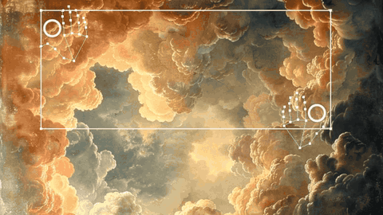
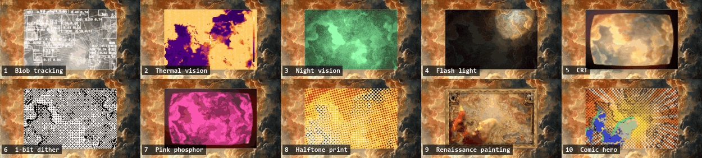
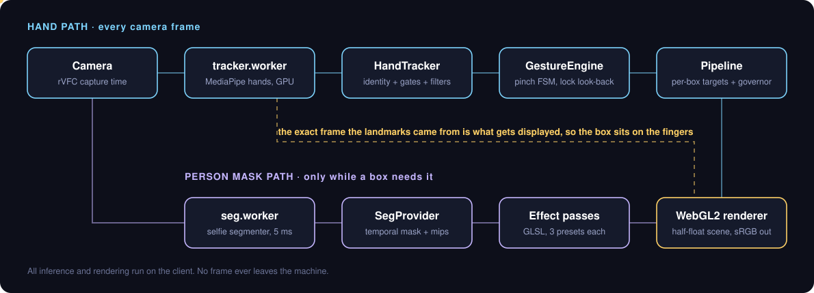
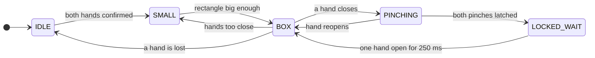

<p align="center">
  
</p>

<p align="center">
  
  
  
  
  
  
</p>

**Pinch-Box is a real-time, hands-only video effects engine that runs entirely in the browser.** Hold up both hands and a rectangle stretches between your fingertips. Pinch with both hands and it locks, and a GPU effect starts running inside it on your live camera feed. Every lock stacks a new box. No controller, no mouse, no cloud.

It is built from scratch on WebGL2 and plain ES modules: a custom hand-validation layer, a gesture state machine, a multi-pass renderer and ten hand-written shader effects. MediaPipe supplies the raw landmarks and person mask. Everything between those models and the pixels is this project.

<p align="center">
  <br>
  <sub>Real capture of the app in its built-in demo mode: synthetic hands drive the actual gesture pipeline, over a painted backdrop.</sub>
</p>

## Highlights

| | |
|---|---|
| **Tracking rate** | 30 Hz, every camera frame processed, even with effects running |
| **Latency** | about 15 ms from frame capture to landmarks ready |
| **Hand inference** | about 10 ms per frame in a Web Worker (RTX 4050) |
| **Person segmentation** | about 5 ms per mask, in a second worker |
| **Rendering** | 200+ fps at the display's refresh rate, in a linear-light half-float scene |
| **Box accuracy** | 1.7 px median error against MediaPipe's fingertips, down from 8.2 px |
| **Size** | about 3,200 lines of JavaScript and GLSL, one runtime dependency, no build step |

Measured on a Windows laptop with an RTX 4050, in Zen (Firefox 159 engine) and Edge. How each number was taken is in [Results](#results).

## The effects

<p align="center">
  <br>
  <sub>All ten effects on a painting. Thermal, Renaissance and Comic hero are built around a person, so they look far stronger on a live camera.</sub>
</p>

| Key | Effect | How it works |
|:---:|---|---|
| `1` | **Blob tracking** | Motion mask read back through a PBO and fence so the GPU never stalls, connected-component labelling in JS, persistent IDs by nearest-centroid matching |
| `2` | **Thermal vision** | Person mask makes you the hot object, a skin test runs hotter than clothes, heat bleeds out through a high mip level, then ironbow palette and sensor noise |
| `3` | **Night vision** | Image-intensifier model: automatic gain from a high video LOD, noise that grows as signal falls, phosphor lag from a 96-frame history ring |
| `4` | **Flash light** | Your index fingertips are the torches: beams follow the tracked palm-to-tip direction, with surface relief catching the light |
| `5` | **CRT** | Barrel distortion, moiré-free RGB aperture grille via `fwidth`, separable bloom, phosphor persistence by ping-pong feedback |
| `6` | **1-bit dither** | 8×8 Bayer, noise or line screens, read against local exposure so bright and dark rooms both keep detail |
| `7` | **Pink phosphor** | Monochrome tube sharing the CRT's multi-pass screen, with long trails and edge-driven burn |
| `8` | **Halftone print** | Per-ink rotated CMYK screens, dot area matched to ink coverage, plate misregistration |
| `9` | **Renaissance painting** | Paints you into a ceiling painting: Kuwahara strokes, oil flesh grading, procedural satin drapery, light sampled from the painting, gold leaf, craquelure, carved gilt frame |
| `0` | **Comic hero** | An original inked character: cel-shaded suit, printed speed-line panel animated on twos, misregistered ghost, energy arcs at your tracked fingertips |

Every effect has live sliders and three presets. Boxes stack in lock order and each one composites over everything beneath it.

## Architecture

<p align="center">
  
</p>

Inference runs in two Web Workers so a slow model can never stall rendering. Frames move to the workers as transferred `ImageBitmap`s and are dropped rather than queued while a worker is busy. All of the tracking and gesture logic is pure JavaScript with no DOM or WebGL, which is what makes it possible to replay and test it headlessly.

The gesture engine is a small state machine:



## Engineering highlights

### Synced display: removing the lag instead of predicting around it

The first version showed the newest camera frame and drew the box from landmarks that were one to three frames older, then tried to hide the gap with velocity extrapolation. The box always trailed the hand. Now each `ImageBitmap` travels through the worker and comes back with its landmarks, and the renderer displays that exact frame. Box and hand are always the same moment in time, so the prediction stack is gone from the normal path. `?sync=0` restores the old behaviour for comparison.

### A bug only real data could find

Synthetic tests all passed, yet the box felt wrong on real hands. Replaying real MediaPipe output frame by frame and measuring **the box actually drawn** showed why: the pinch detector treated any one-frame drop in the thumb-index ratio as a pinch starting, and normal landmark noise (about 0.1 per frame) crossed that on wide-open hands. The box was frozen in 24 of 49 frames.

A first fix, holding only after a pinch registers, stopped that but let the box collapse inward by 52 px on real pinches. The final fix judges closing over a 100 ms window, tuned with a parameter sweep against both goals at once:

| | One-frame test | Hold after latch | **100 ms window** |
|---|:---:|:---:|:---:|
| False freezes on open hands | 24 of 49 | 1 | **3** |
| Box error on open hands (p95) | 42.9 px | 17.9 px | **18.8 px** |
| Box collapse during a pinch (p95) | 3.1 px | 52 px | **10.9 px** |
| Pinch locks found | 20 / 20 | 20 / 20 | **20 / 20** |

### Treating the model's output as noisy evidence

`HandTracker` sits between MediaPipe and everything else. Tracks are matched by continuity rather than the handedness label, which flips. Geometry gates stop non-hands from spawning, a jump gate rejects whole-hand glitches using velocity prediction while never holding real finger motion, and a third hand in the background is ignored. On the real test clip this cut hand-frames wrongly hidden from 55 to 7.

### Rendering without stalls

The render loop allocates nothing. The scene is linear-light half-float with sRGB and triangular dither only at the final blit. Blob analysis reads pixels back asynchronously through a pixel buffer object and a fence, so it never blocks the GPU. All shaders compile during startup so the first lock of an effect never hitches.

A quality governor watches GPU time at p95 and lowers the resolution of the most expensive box first, then pass counts, recovering slowly. It never touches the tracker: hand tracking always wins, and segmentation backs off and pauses if hand inference slows down.

### Replayable, testable by design

Press `R` to record raw landmarks (never video) and replay any session headlessly through the real tracker and gesture code. Synthetic sessions have ground truth and inject glitches: label flips, jumps, dropouts, a third hand and non-hand objects. The tracking and pinch bugs above each have a regression test that fails on the old logic.

## Results

| Metric | Result | How it was measured |
|---|---|---|
| Hand-frames wrongly hidden | 55 → **7** | Real MediaPipe output on a reference clip, replayed through the tracker |
| Fingertip error, p95 | 73 px → **4.8 px** | Tracker fingertip output against raw landmarks, same replay |
| Drawn box error, median | 8.2 px → **1.7 px** | Final on-screen box against the four raw fingertips, same clip |
| Pinch locks | **20 / 20, 0 false** | Synthetic sessions with known truth, including injected glitches |
| Tracking rate with effects on | **30 Hz** | Live app in Zen on a 30 fps stream |
| Capture to landmarks | **about 15 ms** | Same run, measured in the page |
| Automated tests | **44 passing** | `npm test` |

These are honest engineering measurements on one machine, not a formal accuracy study. The replay numbers use a single reference clip, and the live numbers used a fake camera stream.

## Tech stack

| Area | Used |
|---|---|
| **Graphics** | WebGL2, GLSL ES 3.0, half-float render targets, texture arrays, multi-pass feedback, PBO async readback, GPU timer queries |
| **Computer vision** | MediaPipe Tasks Vision (HandLandmarker, ImageSegmenter), connected components, joint bilateral upsampling |
| **Signal processing** | One-Euro filters, critically damped springs, velocity prediction |
| **Runtime** | Vanilla ES modules, Web Workers, `requestVideoFrameCallback`, `ImageBitmap` transfer, `OffscreenCanvas` |
| **Desktop** | Electron portable build for Windows |
| **Testing** | `node:test`, Playwright visual QA and end-to-end runs, headless session replay |

## Getting started

Requires Node.js and a WebGL2 browser with a webcam.

```bash
git clone https://github.com/BeastBoyyy/pinch-box.git
cd pinch-box
npm install
npm run setup     # copies MediaPipe to vendor/ and downloads the models
npm start         # http://localhost:8080
```

After setup it runs fully offline. No camera? Open `http://localhost:8080/?fake=1` for the synthetic-hands demo.

<details>
<summary><b>Controls</b></summary>

| Input | Action |
|---|---|
| Both hands up, thumb and index open | Form the box |
| Pinch both hands | Lock the box |
| `1`-`9`, `0` | Choose the next box's effect |
| `P` | Next preset for the last box |
| `U` / `Esc` | Undo / clear all boxes |
| `C` | Three-second pinch calibration |
| `D` | Debug panel: gates, confidence, live sliders |
| `S` | Hand skeleton overlay |
| `R` / `M` | Record landmarks / mark a lock attempt |
| `Space` / `F` | Pause / fullscreen |

</details>

<details>
<summary><b>URL parameters</b></summary>

| Parameter | Purpose |
|---|---|
| `?fake=1` | Synthetic hands, no camera needed |
| `?src=file.mp4` | Use a video file instead of the camera |
| `?effect=N` | Show one effect on its own |
| `?order=3,1,2` | Change the effect order |
| `?sync=0` | Live video with predicted landmarks instead of the synced frame |
| `?delegate=CPU` | Force CPU inference |
| `?debug=1` | Open with the debug panel |

</details>

<details>
<summary><b>Testing and tooling</b></summary>

```bash
npm test                              # 44 unit, gesture and replay tests
node tools/replay.js session.json     # replay a recorded session with metrics
node tools/replay.js --synthetic 30   # generated session with ground truth
npm run qa                            # screenshot every effect
npm run bench                         # GPU cost per effect
npm run dist                          # build the Windows portable app
```

</details>

## Project structure

```text
src/
├── main.js              wires camera → workers → logic → renderer, owns the render loop
├── camera.js            capture with per-frame timestamps
├── tracker.worker.js    MediaPipe hand inference, off the main thread
├── seg.worker.js        MediaPipe person segmentation, started on demand
├── handTrack.js         identity, geometry gates, coasting, filters      (pure logic)
├── gesture.js           pinch detection, box state machine, calibration  (pure logic)
├── blobs.js             connected components and blob identity           (pure logic)
├── filters.js           One-Euro filters, springs                        (pure logic)
├── governor.js          quality governor                                 (pure logic)
├── pipeline.js          per-box render targets and state
├── render.js            WebGL2 renderer, compositing, overlays
├── segProvider.js       shared temporally smoothed person mask
└── effects/             the ten effects: GLSL, parameters, three presets each
test/                    node:test suites
tools/                   replay, QA, benchmark, end-to-end, setup
docs/                    technical notes, project guide, rationale
```

## Limitations

- Tested on one laptop. Chromium and Firefox engines are covered; Safari is not. The Windows desktop build has not been rebuilt since the current effects landed.
- Works best with front lighting and both hands fully in frame. A hand leaving the picture cannot be tracked.
- The Renaissance and Comic hero looks restyle the camera image through a person mask. They are not rigged 3D models, and the drapery folds do not follow body motion.
- The skin test is colour based, so clothing near skin tone and unusual lighting can confuse it.

## Going deeper

- [Technical notes](docs/TECHNICAL.md): implementation detail, tuning and measurements
- [Project guide](docs/GUIDE.md): exhibition guide, Q&A, troubleshooting and glossary
- [Why this project exists](docs/WHY.md)

## Credits

Built with [MediaPipe Tasks Vision](https://ai.google.dev/edge/mediapipe/solutions/vision/hand_landmarker) (Apache-2.0). The One-Euro filter is from Casiez, Roussel and Vogel, CHI 2012. Inspired by a TouchDesigner screen recording of two-hand box locking, recreated from scratch for the browser.
